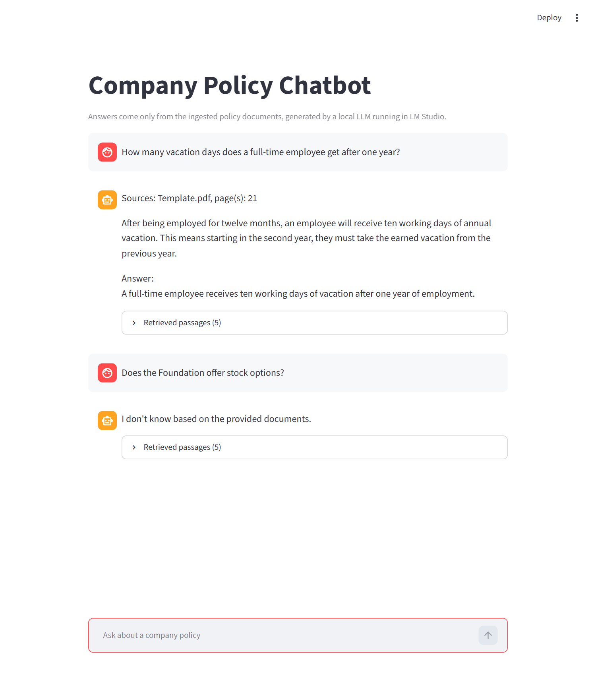

# Company Policy Chatbot (RAG + Local LLM)

A lightweight chatbot that answers company policy questions using a **Retrieval-Augmented Generation (RAG)** pipeline with a **locally hosted LLM (LM Studio)**.

The system retrieves relevant information from internal documents and generates grounded responses, avoiding hallucinations and keeping everything **fully local (no external APIs)**.



---

## Overview

This project demonstrates how to build a practical RAG system end-to-end:

- Ingest company policy documents  
- Convert them into embeddings  
- Store them in a vector database  
- Retrieve relevant context for each query  
- Generate answers using a local language model  

The focus is on understanding how modern AI systems combine **search + generation**, instead of relying on LLMs alone.

---

## Architecture

```
User Query
   ↓
Embedding (MiniLM)
   ↓
Vector Search (Chroma)
   ↓
Relevant Document Chunks
   ↓
Local LLM (LM Studio)
   ↓
Final Answer
```

---

## Tech Stack

- Python  
- LangChain (RAG pipeline orchestration)  
- Chroma (vector database)  
- HuggingFace Embeddings (`all-MiniLM-L6-v2`)  
- LM Studio (local LLM server)  
- Streamlit (web UI)  

### Model

- Local model via LM Studio (e.g. `DeepSeek-R1-Distill-Qwen-7B`)  
- Endpoint: `http://localhost:1234`  

---

## Key Features

- Fully local execution (no API keys, no external calls)  
- RAG-based responses grounded in company documents  
- Modular pipeline (easy to swap embeddings, models, or vector stores)  
- Web chat UI that shows the retrieved passages behind each answer, plus a simple CLI  

---

## Running the Project

```bash
git clone https://github.com/Tuguzbay/company-policy-chatbot.git
cd company-policy-chatbot

python -m venv .venv
.venv\Scripts\activate   # Windows
# or
source .venv/bin/activate   # Mac/Linux

pip install -r requirements.txt
```

### Start Local Model

- Open LM Studio  
- Download and run a model  
- Make sure the server is running at:

```
http://localhost:1234
```

### Build the vector store

Put your policy documents (`.pdf` or `.txt`) in `docs/`, then:

```bash
python ingest.py
```

### Run chatbot

Web UI:

```bash
streamlit run app.py
```

Or in the terminal:

```bash
python chat.py
```

---

## Example

```
You: What is the vacation policy?
Bot: Employees are entitled to...
```

---

## Evaluation Results

The project includes a full evaluation suite (`eval/`) measuring retrieval quality, answer correctness, and hallucination resistance. See [`eval/README.md`](eval/README.md) for details.

| Metric | RAG | Baseline (no retrieval) |
|--------|-----|------------------------|
| Correctness | 0.84 (31/37) | 0.14 (5/37) |
| Groundedness | 0.84 (31/37) | N/A |
| Correct Abstention (unanswerable) | 1.00 (11/11) | 0.82 (9/11) |
| Hit@5 (retrieval) | 0.78 | N/A |
| MRR (retrieval) | 0.57 | N/A |

> 48 questions (37 answerable, 11 unanswerable), `deepseek-r1-distill-qwen-7b` at temperature 0, k=5, chunk size 1000 / overlap 50. Answer labels (correctness, groundedness, abstention) were assigned by an LLM judge (Claude), not by hand.

### Tuning chunking with the eval

The first version used chunk size 500 / overlap 100. The ablation sweep (`eval/ablations.py`) showed 1000 / 50 retrieves better, so `ingest.py` was switched and the full eval re-run:

| Metric | 500 / 100 | 1000 / 50 |
|--------|-----------|-----------|
| Hit@1 | 0.38 | 0.41 |
| Hit@3 | 0.65 | 0.78 |
| Hit@5 | 0.70 | 0.78 |
| MRR | 0.51 | 0.57 |
| Correctness (RAG) | 0.81 (30/37) | 0.84 (31/37) |
| Groundedness (RAG) | 0.89 (33/37) | 0.84 (31/37) |

Retrieval improved clearly. Answer quality did not move much: correctness is up by one question and groundedness is down by two, which is within noise at 37 questions. With larger chunks the model more often had the right passage in context and still missed it or mixed in a neighbouring policy.

---

## What I Learned

- How **RAG systems** work in practice (retrieval + generation)  
- How to use **LangChain** to structure LLM pipelines  
- How embeddings + vector search improve answer quality  
- How to run and integrate **local LLMs via LM Studio**  

---

## Future Improvements

- Web interface (Streamlit / React)  
- Better chunking and retrieval strategies  
- Conversation memory  
- Support for more document formats  

---

## Notes

This project focuses on building a practical AI system that combines retrieval and generation, with everything running locally for simplicity and control.